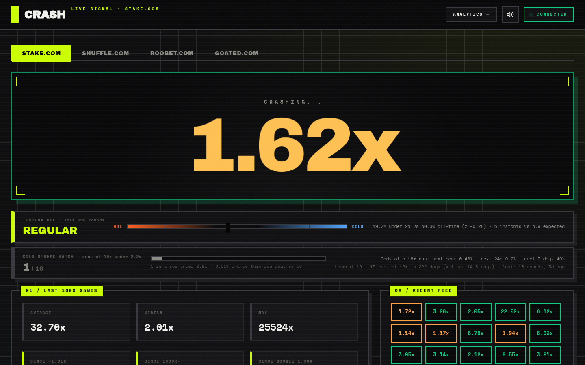
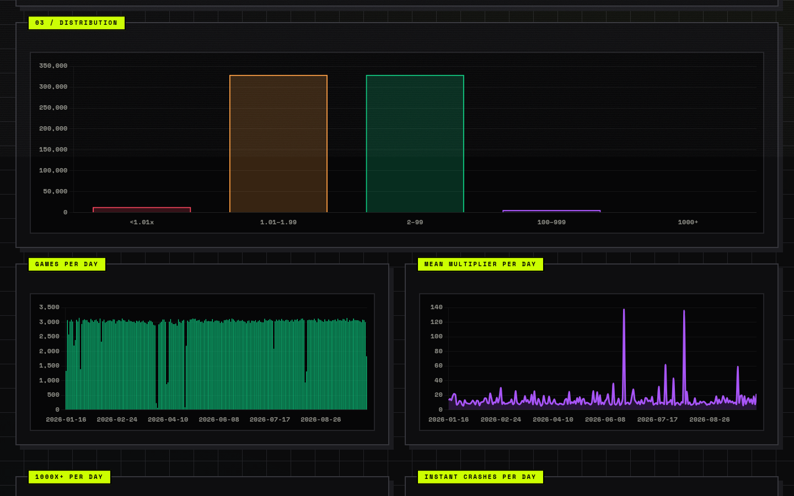
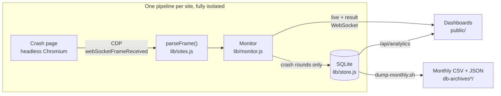

<div align="center">

# Crash Monitor

*Real-time capture, storage and analysis of the Stake.com, Shuffle.com, Roobet.com and Goated.com Crash feeds.*

[](https://nodejs.org)
[](https://pptr.dev)
[](https://sqlite.org)
[](./DOCKER.md)
[](#public-dataset)

[Features](#features) • [Getting started](#getting-started) • [Configuration](#configuration) • [Dashboards](#dashboards) • [Public dataset](#public-dataset) • [API](#api) • [How it works](#how-it-works) • [Deployment](#deployment)



</div>

## Overview

Crash Monitor opens each site's Crash page in a headless browser, reads the live WebSocket stream through the Chrome DevTools Protocol, writes every finished round to SQLite, and serves two dashboards on top: a live view and a period-windowed analytics view, each with one tab per site.

Every site is fully independent, with its own browser, database, streak counters and stall watchdog, so one site going down never disturbs the others' archives.

The monthly exports are committed to this repository, which makes it an open [dataset](#public-dataset) of 639,000+ rounds as well as a tool.

> [!NOTE]
> This tool is **read-only**. It observes public crash feeds without placing bets, clicking, or otherwise interacting with the pages. It is intended for statistical analysis, research and learning.

## Features

- **Four sites, one process**: each site runs in its own browser and writes to its own database. Adding a fifth is [one entry in `lib/sites.js`](#adding-a-site).
- **Network-level capture**: Puppeteer and CDP (`Network.webSocketFrameReceived`) tap each feed directly, and four different wire formats are normalized to one event shape.
- **SQLite persistence**: every round is stored through `better-sqlite3` in WAL mode, with an indexed millisecond timestamp for fast time-window queries.
- **Live dashboard**: multiplier ticker, streak counters, result feed, distribution histogram, a cold / regular / hot temperature gauge and a cold streak watch.
- **Analytics dashboard**: volume, mean, percentiles, distribution, rare-event gaps and top multipliers over any window from `1h` to `all`.
- **Monthly archives**: `dump-monthly.sh` exports per-month CSV and JSON stats for every site, ready for cron.
- **Notifications**: console, Telegram and desktop alerts for instant crashes (`< 1.01x`) and 1000x+ rounds, labelled by site.
- **Built to run unattended**: per-site browser relaunch, a [stall watchdog](#reliability) for silent feed outages, scheduled browser recycling, and `/api/health` for external probes.
- **Deployable**: ships with a systemd unit template and a Docker Compose setup with a persistent volume.

### Supported sites

| Site | Feed | Multiplier precision | Round ID | Database | Archive |
|---|---|---|---|---|---|
| **Stake.com** | GraphQL subscription (JSON) | Full float | UUID | `crash_results.db` | [`db-archives/`](./db-archives) |
| **Shuffle.com** | GraphQL subscription (JSON) | 2 decimals | Integer | `shuffle_crash_results.db` | [`db-archives-shuffle/`](./db-archives-shuffle) |
| **Roobet.com** | Socket.IO, packed binary | 2 decimals (integer hundredths) | Mongo ObjectId | `roobet_crash_results.db` | `db-archives-roobet/` |
| **Goated.com** | JSON on a dedicated socket | Full float | Integer | `goated_crash_results.db` | `db-archives-goated/` |

## Getting started

### Prerequisites

- **Node.js 22.12+** (the floor set by Puppeteer 25, declared in `engines`)
- A Chromium that can launch. Puppeteer downloads its own; on Linux a few shared libraries may be missing (see [Troubleshooting](#troubleshooting))
- About **2 GB of RAM** with all four sites enabled, since each one runs its own headless Chromium

Or just **Docker**, if you would rather install nothing else.

### Run locally

```bash
git clone https://github.com/sebbourgeois/stake-crash-archives.git
cd stake-crash-archives
npm install
cp .env.example .env       # every variable is optional
npm start
```

Then open:

- <http://localhost:3000> for the live dashboard
- <http://localhost:3000/analytics.html> for the analytics dashboard

> [!TIP]
> There is no build step, test suite or linter. `node capture.js` is the entire runtime.

### Run with Docker

```bash
cp .env.example .env       # optional
docker compose up -d --build
docker compose logs -f crash-monitor
```

The image uses Debian's `chromium` package instead of a Chrome download, runs as a non-root user, and keeps the databases on a named volume so they survive rebuilds. Volume migration and container troubleshooting are covered in [`DOCKER.md`](./DOCKER.md).

## Configuration

All configuration is through environment variables. A `.env` file in the project root is loaded automatically, and every variable is optional.

| Variable | Default | Description |
|---|---|---|
| `PORT` | `3000` | HTTP and WebSocket port |
| `DASHBOARD_ENABLED` | `true` | `false` runs a capture-only daemon: no web server, no WebSocket, no API |
| `STAKE_ENABLED`<br>`SHUFFLE_ENABLED`<br>`ROOBET_ENABLED`<br>`GOATED_ENABLED` | `true` | `false` skips that site's browser. Its tab keeps serving what is already archived |
| `DB_PATH` | `crash_results.db` | Stake's SQLite file |
| `SHUFFLE_DB_PATH` | `shuffle_crash_results.db` | Shuffle's SQLite file |
| `ROOBET_DB_PATH` | `roobet_crash_results.db` | Roobet's SQLite file |
| `GOATED_DB_PATH` | `goated_crash_results.db` | Goated's SQLite file |
| `TELEGRAM_ENABLED` | `false` | Send critical alerts to Telegram |
| `TELEGRAM_BOT_TOKEN` | | Bot token from [@BotFather](https://t.me/BotFather) |
| `TELEGRAM_CHAT_ID` | | Chat that receives the alerts |
| `TELEGRAM_SITES` | `all` | Sites allowed to push to Telegram: `all`, `none`, or a list such as `stake,shuffle` |
| `DESKTOP_NOTIFICATIONS_ENABLED` | `false` | Native desktop alerts through `node-notifier` |
| `WATCHDOG_ENABLED` | `true` | Stall watchdog (see [Reliability](#reliability)) |
| `WATCHDOG_STALE_MS` | `180000` | Time without a new result before a site counts as stalled |
| `WATCHDOG_CHECK_MS` | `30000` | How often staleness is checked |
| `BROWSER_RECYCLE_MS` | `21600000` | Relaunch each site's browser this often (6 h). `0` disables |
| `TEMPERATURE_WINDOW` | `300` | Rounds compared against the all-time baseline by the temperature gauge (minimum 50) |
| `STREAK_UNDER_X` | `2.2` | Cold streak watch: a run is consecutive rounds that ended under this multiplier |
| `STREAK_MIN_LEN` | `16` | Cold streak watch: run length that counts as an event (minimum 2) |

> [!IMPORTANT]
> Give every site its own database file. Two sites pointed at one file, or two `capture.js` processes on the same file, will silently drop rows and desync the streak counters.

> [!TIP]
> To find your `TELEGRAM_CHAT_ID`, message your bot, open `https://api.telegram.org/bot<TOKEN>/getUpdates` and copy the `chat.id` field.

## Dashboards

Both pages share a **Stake.com / Shuffle.com / Roobet.com / Goated.com** tab bar. The selected site is mirrored into `?site=` and remembered locally, so it survives a reload, follows you between the two pages, and can be shared as a link (`/?site=roobet`). Every site streams over one WebSocket, so switching tabs is instant and background tabs keep updating.

### Live (`/`)

- Live multiplier with `PREPARING` / `STARTING` / `CRASHING...` / `CRASHED` states
- Average, median and max over the last 1000 rounds
- Streak counters: rounds since the last `< 1.01x`, the last `1000x+`, and the last back-to-back `< 1.01x`
- Distribution histogram and a colour-coded feed of recent results, with optional sound alerts
- **Temperature gauge**: labels the current stretch `COLD`, `REGULAR` or `HOT`. It takes the last `TEMPERATURE_WINDOW` rounds (about two hours), measures the share that ended under 2x, and scores it as a z-score against that site's own all-time share. Past ±2σ the label flips to `COLD` (more early crashes than usual) or `HOT` (fewer).
- **Cold streak watch**: the current run of rounds under `STREAK_UNDER_X`, the site's record, how many runs of `STREAK_MIN_LEN` or more the archive holds, and the odds of one starting in the next hour, day or week.

> [!NOTE]
> Both indicators describe the past, not the future. An unchanged game crosses ±2σ about 5% of the time, and the streak odds treat every round as an independent draw, so they are the same whenever the last run happened. On Stake, a run of 16+ rounds under 2.2x comes up about once a fortnight.

### Analytics (`/analytics.html`)

<div align="center">

</div>

- Period selector: `1h`, `3h`, `12h`, `1d`, `1w`, `1m`, `3m`, `6m`, `all`
- Overview cards: total rounds, days covered, rounds per day, mean, median, p90, p99, highest
- Rare events: count, average gap and longest gap for `< 1.01x` and `1000x+` rounds, the current gap since the last `1000x+`, and the number of back-to-back `< 1.01x`
- Charts for tier distribution, volume, mean multiplier, 1000x+ and instant crashes, bucketed hourly or daily depending on the window
- Top 10 multipliers with timestamps and game IDs

### Multiplier tiers

The same five tiers are used by the dashboards, the analytics API and the archive summaries.

| Tier | Range | Meaning |
|---|---|---|
| Red | `< 1.01x` | Instant crash |
| Orange | `1.01x – 1.99x` | Low |
| Green | `2x – 99.99x` | Standard |
| Purple | `100x – 999.99x` | High |
| Turquoise | `≥ 1000x` | Moon shot |

Multipliers are **truncated** to two decimals for display, matching Stake's own UI: a captured `1.0089275` renders as `1.00x`, not `1.01x`. The database always keeps what the site sent.

## Public dataset

The `.db` files are gitignored, but the monthly archives are committed. Clone or fork the repository and you get every archived round without running the capture yourself.

**Stake**, in [`db-archives/`](./db-archives), from `2026-01-16`:

| Month | Rounds | Days with data | Mean | Median | Max | Instant crash % |
|---|---:|---:|---:|---:|---:|---:|
| `2026-01` | 43,597 | 16 | 12.50x | 1.97x | 40,015x | 1.94 % |
| `2026-02` | 84,786 | 28 | 11.96x | 1.99x | 61,866x | 1.82 % |
| `2026-03` | 78,677 | 28 | 12.51x | 1.99x | 48,465x | 1.90 % |
| `2026-04` | 53,208 | 20 | 11.00x | 1.97x | 47,670x | 2.00 % |
| `2026-05` | 54,312 | 18 | 11.69x | 1.99x | 38,891x | 1.96 % |
| `2026-06` | 91,544 | 30 | 17.06x | 1.99x | 399,026x | 1.97 % |
| `2026-07` | 93,854 | 31 | 13.74x | 1.99x | 116,772x | 2.07 % |
| `2026-08` | 88,325 | 30 | 14.37x | 1.97x | 396,866x | 1.94 % |
| **Total** | **588,303** | | **13.40x** | | **399,026x** | **1.95 %** |

**Shuffle**, in [`db-archives-shuffle/`](./db-archives-shuffle), from `2026-08-15`:

| Month | Rounds | Days with data | Mean | Median | Max | Instant crash % |
|---|---:|---:|---:|---:|---:|---:|
| `2026-08` | 50,789 | 17 | 11.43x | 1.97x | 25,956x | 2.06 % |

**Roobet** (captured since `2026-09-01`) and **Goated** (since `2026-09-30`) get their `db-archives-roobet/` and `db-archives-goated/` directories with their first monthly dump.

The archive is about 77 MB of CSV. Gaps within a month are capture downtime, not missing rounds in the game itself. Each summary's `coverage.largestGapSeconds` and `resultsPerDay` show where they are.

### Getting the data

```bash
# Everything, without the git history
git clone --depth 1 https://github.com/sebbourgeois/stake-crash-archives.git

# Archives only, without the app
git clone --depth 1 --filter=blob:none --sparse \
  https://github.com/sebbourgeois/stake-crash-archives.git
cd stake-crash-archives && git sparse-checkout set db-archives db-archives-shuffle

# A single month, straight over HTTP
curl -O https://raw.githubusercontent.com/sebbourgeois/stake-crash-archives/master/db-archives/crash_2026-07.csv
```

### What's in it

| File | Contents |
|---|---|
| `crash_YYYY-MM.csv` | One row per round: `gameId`, `multiplier`, `timestamp`, `ts_ms`, `iso_utc`, `gamesSinceLast1x`, `gamesSinceLast1000x`, `gamesSinceDouble1x` |
| `crash_YYYY-MM.summary.json` | Stats for that month: count, min, mean, median, p25 to p99, max, tier distribution, cumulative counts at ≥ 1.01 / 2 / 5 / 10 / 50 / 100 / 1000x, rounds per day, coverage |
| `index.csv` | One line per month |
| `summary.json` | Every month's summary plus `totalRows` |

`timestamp` is stored as the site sent it, which for Stake is an HTTP-style date string. Use `ts_ms` (epoch milliseconds) or `iso_utc` for anything that sorts or parses.

```python
import pandas as pd

df = pd.read_csv("db-archives/crash_2026-07.csv", parse_dates=["iso_utc"])
print(df.multiplier.describe(), (df.multiplier < 1.01).mean())
```

> [!NOTE]
> The archive is provided as-is for research and learning. Past rounds say nothing about future ones, and this dataset is not a betting strategy.

## Monthly archives

`dump-monthly.sh` exports each site's database into one CSV and one stats file per calendar month (UTC), each site in its own directory. It opens the databases read-only, so it is safe to run while capture is live.

```bash
./dump-monthly.sh                   # every site that has a database, every month
./dump-monthly.sh -s shuffle        # one site
./dump-monthly.sh -m 2026-07 -z     # one month for every site, gzipped
./dump-monthly.sh -s stake -d other.db -o /mnt/backup
```

| Option | Default | Description |
|---|---|---|
| `-s SITE` | Every site with a database on disk | `stake`, `shuffle`, `roobet` or `goated`. Repeatable |
| `-d DB` | The site's own database | Path to the SQLite file. Needs a single `-s` |
| `-o OUTDIR` | The site's own archive directory | Output directory. Needs a single `-s` |
| `-m YYYY-MM` | Every month | Only this month. Repeatable |
| `-z` | Off | Gzip the generated CSVs |
| `-h` | | Show help |

Re-running overwrites: previously generated files are removed first, so stale months never linger. With `-m` only the selected months are touched, and the roll-ups are rebuilt from every summary in the output directory. A site whose dump fails does not stop the others; the run finishes the rest, then exits non-zero and names what failed.

### Scheduling with cron

`dump-last-month.sh` resolves the previous calendar month and passes it to `dump-monthly.sh`. It covers every site that has a database, so one line is enough:

```cron
5 0 1 * * /path/to/stake-crash-archives/dump-last-month.sh >> /path/to/stake-crash-archives/dump-monthly.log 2>&1
```

Backfill with `MONTH=2026-03 ./dump-last-month.sh`. Extra flags are passed through, for example `./dump-last-month.sh -z`.

Refreshing a fork's archives is then two commands:

```bash
./dump-last-month.sh
git add db-archives*/ && git commit -m "Archive $(date -u -d 'last month' +%Y-%m)"
```

> [!IMPORTANT]
> The script needs a Node that can load the compiled `better-sqlite3` binding. It tries `$NODE_BIN`, then `PATH`, then any nvm-installed versions, and uses the first that works. If none do, run `npm rebuild better-sqlite3` or set `NODE_BIN=/path/to/node`.

## Reliability

### Stall watchdog

A capture can stall silently: the process stays alive and the event loop keeps running, but a site stops delivering WebSocket frames. Nothing throws, so neither the retry loop nor the supervisor notices. This repository's own Stake database has a 7.8 h gap and a 54 h gap that both happened inside a single long-lived process.

"No row written for `WATCHDOG_STALE_MS`" is therefore the liveness signal, and each site is watched separately:

1. **Relaunch that site's browser** in-process, then give it one more full window.
2. If that window also passes with no result:
   - **every enabled site is stale**: the process is wedged, so it exits with status 1 and the supervisor (`Restart=always` under systemd, `restart: unless-stopped` under Compose) starts it fresh.
   - **another site is still healthy**: only the stalled site keeps relaunching. Restarting the process would punch a hole in the healthy site's archive to fix a problem it does not have.

Step 1 is routine self-healing and only logs. Step 2 sends a Telegram alert, repeated about once an hour while the outage lasts.

> [!NOTE]
> The default threshold comes from 90 days of Stake data: gaps over 3 min happened 57 times, over 5 min 12 times, over 6 min 7 times, and every gap past 6 min was a real outage. The default therefore triggers a cheap browser relaunch every other day or so and restarts the service only when it matters. Raise `WATCHDOG_STALE_MS` to `300000` for fewer relaunches.

### Browser recycling and CPU

The crash pages are single-page apps that leak memory while left open: a Stake renderer measured 2.1 GB after four days and a Roobet one 9.2 GB after 24 hours. Each site's browser is therefore relaunched every `BROWSER_RECYCLE_MS`, and never mid-round: the relaunch waits for the next persisted crash, with a two-minute grace period if none arrives. As a backstop, a renderer that outgrows a 1 GB V8 heap is killed and relaunched by the retry loop.

Once the listener is attached, the crash page is parked behind a blank foreground tab. That pauses the page's 60 fps canvas animation, which was costing about a CPU core per site, while frames keep arriving at the network layer.

## API

The monitor exposes a small HTTP and WebSocket surface, used by the bundled dashboards. Everything is scoped by a site key: `stake`, `shuffle`, `roobet` or `goated`.

| Endpoint | Description |
|---|---|
| `GET /api/sites` | `[{ key, label, tab, url, enabled }]`, the source of the tab bar |
| `GET /api/analytics?site=<key>&period=<period>` | Aggregates for one site over `1h`, `3h`, `12h`, `1d`, `1w`, `1m`, `3m`, `6m` or `all`. `site` defaults to `stake`; an unknown site returns `400` |
| `GET /api/health` | `200` while every enabled site is fresh, `503` once any of them passes its staleness window |
| `ws://<host>:<port>/` | Live stream for every site. Each message carries its `site` |

`/api/health` reports each site separately. The top-level `staleSeconds` is the worst enabled site's:

```jsonc
{
  "ok": true, "staleSeconds": 22, "thresholdSeconds": 180,
  "watchdogEnabled": true, "uptimeSeconds": 487,
  "sites": {
    "stake":   { "ok": true, "enabled": true, "staleSeconds":  6, "lastResultMs": 1790778064156, "staleStrikes": 0 },
    "shuffle": { "ok": true, "enabled": true, "staleSeconds":  6, "lastResultMs": 1790778063772, "staleStrikes": 0 },
    "roobet":  { "ok": true, "enabled": true, "staleSeconds": 12, "lastResultMs": 1790778057570, "staleStrikes": 0 },
    "goated":  { "ok": true, "enabled": true, "staleSeconds": 22, "lastResultMs": 1790778047638, "staleStrikes": 0 }
  }
}
```

<details>
<summary><b>WebSocket messages</b></summary>

<br>

There are three message shapes, all JSON:

```jsonc
// 1. On connect, one per site: the last 1000 results and the current indicators
{ "type": "history", "site": "shuffle", "results": [ ... ], "streaks": { ... }, "temperature": { ... }, "streakOdds": { ... } }

// 2. Live state, on every frame (starting / start / in_progress / crash)
{ "type": "live", "site": "stake", "state": { "status": "in_progress", "multiplier": 1.42, "gameId": "..." } }

// 3. A persisted round, with both indicators recomputed to include it
{ "type": "result", "site": "stake", "result": { "gameId": "...", "multiplier": 7.31, "timestamp": "...", "ts_ms": 1790778064156, ... }, "temperature": { ... }, "streakOdds": { ... } }
```

`temperature` is `null` until the site has archived at least twice `TEMPERATURE_WINDOW` rounds:

```jsonc
{
  "window": 300, "label": "cold",          // "cold" | "regular" | "hot"
  "z": 2.04, "threshold": 2,               // z-score of the under-2x share; |z| >= threshold flips the label
  "pctLt2": 56.3, "instants": 7, "expectedInstants": 5.9,
  "baseline": { "total": 612563, "pctLt2": 50.4, "pctInstant": 1.95 }
}
```

`streakOdds` is `null` until the site has archived 1000 rounds:

```jsonc
{
  "threshold": 2.2, "minLen": 16,
  "current": 3, "longest": 19, "count": 13,                      // current run, record run, runs that reached minLen
  "last": { "len": 19, "startMs": 1788..., "endMs": 1788... },   // latest run that reached minLen, or null
  "total": 617565, "pUnder": 0.5496,                             // rounds archived; all-time share under the threshold
  "perRound": 3.12e-5, "reach": 0.0003,                          // P(a round starts a minLen+ run); P(current run reaches minLen)
  "roundsPerDay": 3053, "coveredDays": 202.3, "observedPerDay": 0.064,
  "odds": { "hour": 0.004, "day": 0.091, "week": 0.487 }         // P(at least one run starts in the window)
}
```

</details>

## How it works



1. For each site, Puppeteer launches headless Chromium and loads that site's crash page.
2. A CDP session subscribes to `Network.webSocketFrameReceived`. This happens **after** navigation, because enabling `Network` on `about:blank` and then navigating makes Chrome stop delivering frames to that session.
3. The site's `parseFrame()` turns each raw frame into `{ status, gameId, multiplier, timestamp }`. Stake and Shuffle send GraphQL JSON, Goated plain JSON, and Roobet packed binary Socket.IO payloads. This is the only place those differences live.
4. Live state is broadcast for every status. **Only `crash` is persisted**, deduplicated by `gameId`.
5. Express serves `public/` and the API, and the `ws` server pushes site-tagged updates over the same HTTP server.
6. Streak counters, the temperature baseline and the streak state are seeded from each database at startup, so they survive restarts.

| File | Role |
|---|---|
| `capture.js` | Wiring: builds one monitor per site, serves the API and WebSocket, owns the watchdog ladder, notifications and shutdown |
| `lib/sites.js` | Everything site-specific: page URL, env var names and the frame parser |
| `lib/store.js` | One SQLite file: schema, migration, history, analytics, temperature and streak odds |
| `lib/monitor.js` | One site's capture loop: browser, retry, recycle, streaks, dedupe, staleness clock |
| `public/` | Both dashboards. `site-tabs.js` is shared between them |
| `dump-monthly.sh`, `dump-last-month.sh` | Monthly archive export and its cron entry point |

### Data model

Every site uses the same schema in its own file:

```sql
CREATE TABLE crash_results (
  gameId               TEXT    PRIMARY KEY,    -- dedupe boundary, unique within one site
  multiplier           REAL    NOT NULL,
  timestamp            TEXT    NOT NULL,       -- as sent by the site, or the receive time
  ts_ms                INTEGER,                -- epoch ms, indexed (idx_ts_ms)
  gamesSinceLast1x     INTEGER,
  gamesSinceLast1000x  INTEGER,
  gamesSinceDouble1x   INTEGER
);
```

Because `gameId` is the primary key, reconnects and restarts never produce duplicate rows. The schema is created on first launch, and `ts_ms` is added and backfilled automatically for older databases.

### Adding a site

Add an entry to `SITES` in `lib/sites.js` (page URL, env var names and a `parseFrame()` that returns the normalized event), plus a row in the site tables at the top of `dump-monthly.sh`. Nothing else: `capture.js` iterates `SITES`, and both dashboards build their tabs from `GET /api/sites`.

## Deployment

### systemd

`stake-crash.service.example` is a unit template. Run this from the repository checkout, as the unprivileged user the service should run as, with the same Node on `PATH` that you ran `npm install` with:

```bash
sed -e "s|__USER__|$USER|g" \
    -e "s|__WORKDIR__|$PWD|g" \
    -e "s|__NODE__|$(command -v node)|g" \
    stake-crash.service.example | sudo tee /etc/systemd/system/stake-crash.service
sudo systemctl daemon-reload
sudo systemctl enable --now stake-crash
journalctl -u stake-crash -f
```

Then check `curl -s localhost:3000/api/health`. A `200` with a low `staleSeconds` means rounds are actually being written, which `systemctl status` alone does not tell you.

> [!IMPORTANT]
> `ExecStart` must use an absolute `node` path on the **same Node major that built `node_modules`**. `better-sqlite3` is a native addon, so installing dependencies under a different major makes the unit die at startup with `ERR_DLOPEN_FAILED`. After a Node upgrade, run `npm rebuild better-sqlite3` and update the path. nvm does not exist under systemd, so a bare `node` will not resolve.

### Docker

`docker compose up -d --build` is the whole deployment. See [`DOCKER.md`](./DOCKER.md) for the image layout, moving an existing database into the named volume, and container-specific troubleshooting.

## Troubleshooting

**Puppeteer fails to launch on Linux.** Install the shared libraries Chromium needs:

```bash
sudo apt-get install -y libnss3 libatk1.0-0 libatk-bridge2.0-0 libcups2 libdrm2 \
  libxkbcommon0 libxcomposite1 libxdamage1 libxfixes3 libxrandr2 libgbm1 libasound2
```

**The dashboard shows "Disconnected".** The WebSocket client reconnects on its own. If it stays disconnected, the server is down; check its logs.

**One site's tab is empty or stuck.** Check `/api/health`: `sites.shuffle.staleSeconds` climbing past `thresholdSeconds` while the others stay low means only that capture is down. Logs are prefixed per site (`[SHUFFLE] Capture error: ...`), and a failed capture retries after 10 seconds.

**`dump-monthly.sh` cannot load `better-sqlite3`.** The native module is built for one Node ABI and the `node` on your `PATH` may be another. Run `npm rebuild better-sqlite3`, or point the script at a known-good binary with `NODE_BIN=/path/to/node ./dump-monthly.sh`.

> [!CAUTION]
> These sites rate-limit automated clients. Running several instances from the same IP is likely to get the session blocked.
